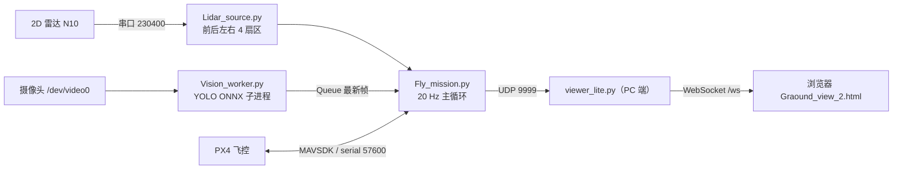

# 无人机走廊自动巡检

室内走廊自主巡检原型。无人机在走廊中**侧飞贴墙**，用 2D 雷达维持离墙距离与机头朝向，用 YOLO 识别墙上的消防栓并检查柜内器材是否齐全，全程在地面站网页上实时可视化。

> 状态：**全流程已跑通** —— 起飞 → 转航向 → 贴墙定位 → 侧飞 → 识别 3 个消防栓 → 自动降落，网页实时同步位置、航向与检测结果。

---

## 目录结构

```
drone/
├── Control/
│   ├── Fly_mission.py      ⭐ 主程序（5 阶段飞行 + 视觉巡检 + 网页上报）
│   ├── Lidar_source.py       雷达驱动（统一接口，前后左右 4 扇区）
│   ├── Lidar_check.py        雷达静态自检
│   ├── Link_test.py          飞控链路测试
│   └── Takeoff_test.py       起飞测试
├── vision/
│   ├── Vision_worker.py    YOLO ONNX 推理子进程
│   └── Yolo_test.py          视觉单独自检（不飞也能跑）
├── Viewer/
│   ├── viewer_lite.py        地面站服务器（零依赖：UDP → WebSocket → HTML）
│   ├── Graound_view_2.html   走廊可视化页面（Canvas）
│   └── Fake_data.py          假数据注入，单独验证网页链路
└── docs/
    └── PROJECT_STATE.md      完整技术档案与调试记录
```

---

## 系统架构



三条**互相独立**的通路：控制（雷达 → 主循环 → PX4）、视觉（摄像头 → 子进程 → Queue）、可视化（主循环 → UDP → 网页）。任何一条断掉都不会阻塞另外两条。

---

## 硬件

| 部件 | 型号 / 说明 |
|---|---|
| 飞控 | MicoAir743v2（STM32H743VIT6），PX4 NuttX-11.0.0 |
| 机载电脑 | Orange Pi 4 Pro（aarch64 / Ubuntu 22.04 / Python 3.10） |
| 2D 雷达 | N10，帧头 `A5 5A 3A`，55 字节/帧，16 点/帧 |
| 摄像头 | USB `/dev/video0`，MJPG 640×480 @30fps |
| 定位 | 室内无 GPS，靠光流 + 下视测距做 EKF 位置估计 |

| 连接 | 设备节点 | 波特率 |
|---|---|---|
| 飞控 ↔ 机载电脑 | `/dev/pixhawk` | 57600 |
| 2D 雷达 | `/dev/wheeltec_lidar` | 230400 |

---

## 软件环境

```bash
cd ~/drone
python3 -m venv venv
source venv/bin/activate
pip install -r requirements.txt -i https://pypi.tuna.tsinghua.edu.cn/simple
```

| 包 | 版本 | 说明 |
|---|---|---|
| `mavsdk` | 3.17.4 | **必须 < 4**，4.x 接口不兼容 |
| `grpcio` | 1.84.0 | MAVSDK 依赖 |
| `pyserial` | 3.5 | 雷达串口 |
| `opencv-python` | 5.0.0.93 | 视觉推理 + 摄像头 |
| `numpy` | 2.2.6 | |

> aarch64 上装不了 `ultralytics`（torch 依赖问题），所以视觉走 **ONNX + `cv2.dnn`** 这条路，CPU 推理约 15–16 FPS。
> 地面站 `viewer_lite.py` 只用 Python 标准库，**不需要 fastapi / uvicorn**。

---

## 运行顺序

### 1. 雷达自检（不上电，只插雷达）

```bash
cd ~/drone/Control
python Lidar_check.py
```

确认：读数稳定、手推飞机时 `front` / `back` 一增一减、**`left + right ≈ 2.49 m`**。

### 2. 视觉自检（不飞）

```bash
cd ~/drone/vision
python Yolo_test.py
```

### 3. 地面站（PC 端）

```bash
cd Viewer
python viewer_lite.py
# 浏览器打开 http://localhost:8000
```

页面右上角 `DEMO` = 还没收到真实数据；绿色 `LIVE` = 已连上飞机。

### 4. 起飞前必须改的两个配置

`Control/Fly_mission.py` 顶部：

```python
VIEWER_HOST = "192.168.x.x"   # ⚠️ 改成跑 viewer_lite.py 那台电脑的 IP（ipconfig 查）
```

`vision/Vision_worker.py` 顶部：

```python
MODEL_PATH = "/home/orangepi/drone/Vision/best.onnx"   # ⚠️ 改成模型实际路径
```

### 5. 飞行

```bash
cd ~/drone/Control
python Fly_mission.py
```

**停止方式：按回车。**（Ctrl+C 会连带杀掉 `mavsdk_server`，导致 `offboard.stop()` 和 `land()` 全部失败）

---

## 飞行流程

### 前置检查（不飞，只验证）

| 检查项 | 判据 | 不通过会怎样 |
|---|---|---|
| 机头**沿走廊**摆放 | `front + back ≥ 3.5 m` | 直接退出（脚本就是按"机头沿走廊"设计的） |
| 飞机在走廊中间 | `left + right ≈ 2.49 ± 0.15` | 直接退出 → 检查 `LEFT_DEG` / `RIGHT_DEG` |
| 起飞点居中 | `abs(left − right) ≤ 0.30 m` | 仅告警 |
| EKF 位置 | `is_local_position_ok`（30 s 超时） | 直接退出 |
| 视觉就绪 | 20 s 内收到一帧检测结果 | 取消起飞 |

### 五个阶段

| 阶段 | 做什么 | 谁写控制量 | 退出条件 |
|---|---|---|---|
| **① climb** | 爬升到 `CLIMB_STOP_M = 1.30 m`，同时左右居中 | `down` + `right` | `alt ≥ 1.30` |
| **①b settle** | 原地等稳定（**不先停住就不许转**） | 只有 `right` | `abs(v) < 0.15` 且 `abs(e_side) < 0.20` 且 `abs(alt−1.20) < 0.08`，连续 0.5 s |
| **② turn** | 左转 88°，**只用 yaw 遥测判据** | 只有 `yawspeed` | `abs(误差) ≤ 3°`，超时 6 s |
| **③a mid** | 前后环归位到走廊中点 `e_lat = 0`（**检查点**） | `forward` + `yawspeed` | `abs(e) < 0.08 m` |
| **③b tgt** | 2 s 斜坡把定位点拉到 `front = 1.65 m` | `forward` + `yawspeed` | `abs(e) < 0.06 m` |
| **④ side** | 向右侧飞 `0.44 m/s`，视觉滑窗找消防栓 | `right` + `forward` | 计满 3 个 / 超时 240 s / 触发保护 |
| **⑤ inspect** | 原地悬停 6 s，累积各帧检出并判定柜内是否齐全 | 只有 `forward` | 6 s 到 |

**视觉触发**：滑动窗口 `HYDRANT_WINDOW_N = 6` 帧，其中 `≥ HYDRANT_HITS = 1` 帧看到 `Fire_hydrant` 就触发；触发后 `RESUME_COOLDOWN_S = 12 s` 内不重复计数（`0.44 × 12 ≈ 5.3 m`，远大于相机视野覆盖宽度，防止同一个柜子被数两次）。

**检视结算**：`inspect` 结束后核对 4 类必需器材（`Valve` / `Fire_hose` / `Fire_nozzle` / `Rubber_hose`），缺哪类就标记 `missing`。**计满 `TARGET_HYDRANT_COUNT = 3` 个 → 任务完成 → 自动降落。**

### 坐标与误差定义

```python
alt    = -current["down"]                        # NED 的 down 取负
e_lat  = (front - back) / 2 - e_target           # 前后环误差
e_side = right - left                            # 左右居中误差，>0 = 偏左
E_LAT_TARGET_M = FRONT_TARGET_M - W_NOMINAL_M/2  # = 1.65 - 1.245 = +0.455
```

---

## 关键参数

全部在 `Control/Fly_mission.py` 顶部配置区。**一次只改一个，改完记下来。**

### 走廊几何

| 参数 | 值 | 含义 |
|---|---|---|
| `W_NOMINAL_M` | `2.49` | 走廊宽度标定值（`left+right` 与 `front+back` 都要对上它） |
| `W_TOL_M` | `0.15` | 超差多少判读数不可信（门洞、开柜时会触发） |

### 高度

| 参数 | 值 | 含义 |
|---|---|---|
| `ALT_TARGET_M` | `1.20` | 目标悬停高度（m） |
| `CLIMB_RATE` | `-0.35` | 爬升速度命令（NED，负 = 向上） |
| `CLIMB_STOP_M` | `1.30` | 爬到这高度停止爬升，之后回落到 1.20 |
| `TAKEOFF_TIMEOUT_S` | `30.0` | 起飞超时（s） |
| `KP_ALT_P` | `0.50` | 高度环 P（`alt_hold_task` 专用，只写 `down`） |

### 阶段①：起飞时左右居中

| 参数 | 值 | 含义 |
|---|---|---|
| `SIDE_ON_ALT_M` | `0.15` | 高于此高度才开左右环（贴地读数不可信） |
| `KP_SIDE` / `KI_SIDE` | `0.65` / `0.05` | 左右环增益 |
| `KV_SIDE` | `1.80` | **速度阻尼**，用 EKF 机体右速度做微分项（比差分干净） |
| `MAX_RIGHT` | `0.30` | `right` 限幅（m/s） |
| `SIDE_DEADBAND_M` | `0.04` | 死区（m） |
| `SIDE_ABORT_M` | `0.90` | 偏离中线超此值 → 中止 |

### 阶段②：转航向

| 参数 | 值 | 含义 |
|---|---|---|
| `TURN_DEG` / `TURN_SIGN` | `88.0` / `-1.0` | 左转 88°（留 2° 给阶段③的航向环收尾） |
| `TURN_RATE` / `TURN_GAIN` | `60.0` / `3.0` | 限速（deg/s）+ P 律（末端自动减速） |
| `TURN_TOL_DEG` / `TURN_TIMEOUT_S` | `3.0` / `6.0` | 到位判据与超时 |
| `TURN_VDAMP` / `TURN_VDAMP_MAX` | `1.20` / `0.20` | 转向期间的平移速度阻尼（消除甩尾） |
| `W_SANITY_M` | `0.25` | 转完后 `abs(W − 2.49)` 超此值 → 中止（说明没转正） |

---

### 阶段③④：前后环

| 参数 | 值 | 含义 |
|---|---|---|
| `FRONT_TARGET_M` | `1.65` | 作业时的离墙距离（m） |
| `E_LAT_TARGET_M` | `+0.455` | 由上一行自动算出 |
| `MID_ELAT_M` / `MID_TOL_M` | `0.00` / `0.08` | 中点检查点目标与容差 |
| `TGT_TOL_M` | `0.06` | 前移到位容差 |
| `TGT_RAMP_S` | `2.0` | 目标斜坡时间（避免阶跃冲击） |
| `KP_LAT` / `KI_LAT` / `KD_LAT` | `0.70` / `0.10` / `0.0` | 前后环 PID |
| `MAX_FORWARD` | `0.40` | `forward` 限幅（m/s） |
| `WALL_ABORT_M` | `0.85` | `abs(e)` 超此值 → 停止纠偏并清积分 |

### 航向环

| 参数 | 值 | 含义 |
|---|---|---|
| `USE_YAW_LOOP` | `True` | 是否启用 |
| `KP_YAW` | `3.0` | 输入单位是**度**，输出是 **deg/s** |
| `MAX_YAWRATE` | `10.0` | 限幅（deg/s） |
| `YAW_DEADBAND_DEG` | `1.5` | 死区 |
| `YAW_ABORT_DEG` | `25.0` | 超此角度 → 停止纠正（大概率雷达看到门洞了） |

---

### 阶段④：侧飞 + 视觉

| 参数 | 值 | 含义 |
|---|---|---|
| `V_SIDE` / `SIDE_DIR` | `0.44` / `+1.0` | 侧飞速度（m/s），`+1` = 向右 |
| `SIDE_TIME_S` | `240.0` | 侧飞时长上限（s） |
| `VIS_ENABLE` | `True` | 设 `False` 即退化为纯定距飞行 |
| `TARGET_CLASS` | `"Fire_hydrant"` | 触发用的类别 |
| `REQUIRED_CLASSES` | `Valve / Fire_hose / Fire_nozzle / Rubber_hose` | 柜内必需器材 |
| `IGNORE_CLASSES` | `Fire_extinguisher` | 不计入判定 |
| `HYDRANT_WINDOW_N` / `HYDRANT_HITS` | `6` / `1` | 滑窗帧数 / 命中阈值 |
| `INSPECT_S` / `DECEL_S` | `6.0` / `0.1` | 悬停检视时长 / 刹车斜坡时间 |
| `TARGET_HYDRANT_COUNT` | `3` | 认满几个就降落（`0` = 不按数量停） |
| `RESUME_COOLDOWN_S` | `12.0` | 两次触发最小间隔（s） |
| `VISION_STALE_S` | `1.0` | 视觉数据超过 1 s 未更新算失效 |

### 全程保护

| 参数 | 值 | 含义 |
|---|---|---|
| `SIDE_STOP_FRONT` | `0.70` | `front` 低于此值 → 立即中止 |
| `BACK_MIN_SAFE` | `0.50` | `back` 低于此值 → 立即中止 |
| `LIDAR_MIN_ALT_M` | `0.50` | 低于此高度不信任雷达 |
| `MAX_JUMP_M` / `MAX_BAD_CNT` | `0.25` / `8` | 单帧跳变先拒收，连续 8 次才认账 |
| `LOST_TIMEOUT_S` | `1.0` | 丢墙多久算真丢 |

### 雷达扇区（`Lidar_source.py`）

| 参数 | 值 | 含义 |
|---|---|---|
| `FRONT_DEG` / `BACK_DEG` | `0` / `180` | 前墙 / 后墙 |
| `LEFT_DEG` / `RIGHT_DEG` | `270` / `90` | 左墙 / 右墙（**方向反了就交换这两个值**） |
| `WALL_HALF` / `SIDE_HALF` | `20` / `20` | 扇区半宽（度） |
| `YAW_DELTA` / `YAW_HALF` | `15` / `5` | 两侧子扇区的中心角与半宽，用来算机头偏角 |
| `YAW_SIGN` | `-1.0` | 偏角符号（实测确认） |
| `SMOOTH_N` | `2` | 时间平滑窗口（近 2 圈取中位数） |

### 视觉推理（`Vision_worker.py`）

| 参数 | 值 | 含义 |
|---|---|---|
| `IN_W` / `IN_H` | `320` / `320` | 网络输入尺寸（letterbox 预处理） |
| `CONF_THRES` | `0.20` | 全局置信度阈值 |
| `CLASS_CONF` | `Fire_nozzle: 0.18` | 该类模型较弱，单独放宽 |
| `NMS_THRES` | `0.45` | NMS 阈值 |
| `CLASSES` | 6 类 | `Fire_extinguisher / Fire_hose / Fire_hydrant / Fire_nozzle / Rubber_hose / Valve` |

### 网页与地面站

| 参数 | 值 | 含义 |
|---|---|---|
| `VIEWER_ENABLE` | `True` | 是否上报网页 |
| `VIEWER_PORT` | `9999` | UDP 目标端口（`viewer_lite.py` 的 `UDP_PORT`） |
| `VIEWER_PERIOD_S` | `0.10` | 上报周期（10 Hz） |
| `VIEWER_WALL_N` | `1.245` | 必须与 HTML 的 `WALL_N` 一致 |
| `CORRIDOR_LEN` | `40.0` | 走廊总长（m，HTML） |
| `TARGET_DIST` | `1.65` | 应与 `FRONT_TARGET_M` 一致（HTML） |
| `HYDRANT_POS` | `[2.4, 18.5, 34.5]` | 三个消防栓距起飞点（m，HTML） |

---

## 网页数据协议

`Fly_mission.py` →（UDP 9999）→ `viewer_lite.py` →（WebSocket `/ws`）→ 浏览器。

**`pos` 消息（10 Hz）**

```json
{"type":"pos","north":-0.405,"east":12.34,"down":-1.2,"yaw":-87.5,"hyd":1}
```

- `north = 1.245 − front`（由雷达实时反算，所以图上飞机永远贴在墙上）
- `east` = 相对**侧飞起点**的沿走廊投影距离
- `yaw` = 相对侧飞起点的航向差
- `hyd` = 已确认的消防栓个数

**`det` 消息（每次检视结束发一次）**

```json
{"type":"det","east":2.40,"index":0,"status":"ok","counts":{"Fire_hydrant":2,"Valve":1},"missing":[]}
```

`index` 为消防栓序号（0 起），网页据此把它挪到实测位置，**保证演示位置与真实检测结果一致**。

> 网页收到第一帧消息前保持 `DEMO`（本地动画演示），收到后切为 `LIVE`。
> 一直 `DEMO` 的内部原因只有一个：`VSTATE["ready"]` 未置位 —— 它只在进入阶段④时置位，所以飞行在阶段③之前中止时网页不会变 LIVE。

单独验证网页链路（不用飞）：

```bash
# PC 端先起 viewer_lite.py；在另一台机器上改 Fake_data.py 的 HOST 为 PC 的 IP
cd Viewer
python Fake_data.py
```

---

## 设计约束（改代码前必须知道）

这几条是踩坑换来的，违反了会直接导致飞行中断：

1. **每个控制通道只有一个写入者**
   `cmd["forward"] / cmd["right"] / cmd["yawspeed"]` 只由主循环写；`cmd["down"]` 除起飞阶段外只由 `alt_hold_task` 写；`send_velocity` 只读不写。

2. **雷达只能有一个读者**
   `lidar.read()` 只在主循环里调用，其它任务（`guard_task`、`viewer_task`）只读 `dist` 快照。两个读者会阻塞 asyncio 事件循环 → `send_velocity` 断流 → PX4 掉出 offboard。

3. **视觉子进程必须在 MAVSDK 连接之前 fork**
   否则子进程会继承 gRPC socket，导致飞控连接异常。见 `__main__` 里的注释。

4. **丢墙时指令直接归零，不要"保持"**
   门洞会让 `front + back` 对不上 2.49 → 判 `bad`。此时 `fwd = 0` 并清积分，比按旧方向硬推安全得多。

5. **`yawspeed` 单位是 deg/s**
   航向环内部用度，输出直接给 PX4。用弧度会弱 57.3 倍。

6. **`WALL_N = 1.245` 有三处必须一致**
   `Graound_view_2.html` 的 `WALL_N`、`Fly_mission.py` 的 `VIEWER_WALL_N`、`Fake_data.py` 的 `WALL_N`。

---

## 故障排查

| 现象 | 原因 | 处理 |
|---|---|---|
| 网页一直是 `DEMO` | ① `VIEWER_HOST` 写错 ② UDP 没到 ③ 飞行没进阶段④ | 看终端有没有打印 `🗺️ 网页锚定` |
| 网页 `LIVE` 但飞机位置不动 | `north` / `east` 算错 | 核对 `VIEWER_WALL_N` 与 `FRONT_TARGET_M` |
| 雷达 `front+back ≈ 10 m` | 机头朝走廊而不是朝墙 | 飞机转 90°，脚本前提是机头沿走廊 |
| `left+right ≠ 2.49` | `LEFT_DEG` / `RIGHT_DEG` 装反 | 交换这两个值 |
| `❌ 10 秒没拿到完整数据` | 用了旧的 `Lidar_source.py` | 用 `Control/` 下那份（`SMOOTH_N=2`） |
| 视觉一直不触发 | 模型路径错 / 相机被占用 / 光照不足 | 先单独跑 `vision/Yolo_test.py` |
| 脚本退出但飞机还在飞 | 收尾失败 | **立刻遥控切 POSCTL 接管** |
| 转完航向后 `W` 对不上 | 没转正或有遮挡 | 检查 `TURN_DEG`、确认走廊宽度真是 2.49 |

---

## 已知限制

- 走廊宽度按 `2.49 m` 标定，换场地需重新标 `W_NOMINAL_M`
- 门洞 / 打开的柜门会让 `front + back` 失配，此时前后环暂停（`fwd = 0`），靠惯性通过
- 网页坐标以**侧飞起点**为原点，起飞前的轨迹不上报
- 模型 `best.onnx` 不在仓库里（体积与版权原因），需自行训练后放到 `MODEL_PATH`
- 视觉为 CPU 推理（约 15–16 FPS），侧飞速度快时可能漏检，`V_SIDE` 不宜再往上加

---

## 参考

- [PX4 光流 + 测距配置](https://docs.px4.io/main/en/sensor/optical_flow.html)
- [MAVSDK-Python 文档](https://mavsdk.mavlink.io/main/en/python/)
- 完整调试记录：[`docs/PROJECT_STATE.md`](docs/PROJECT_STATE.md)

